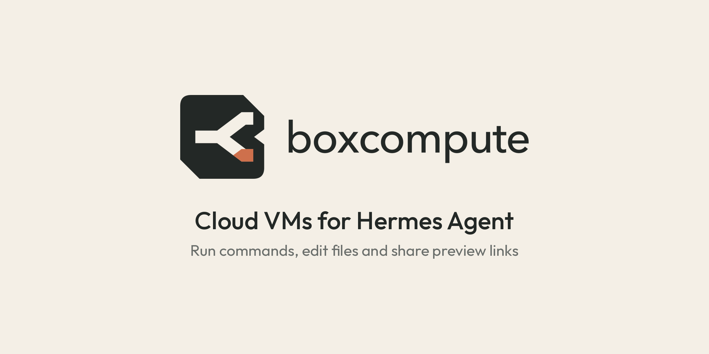

# BoxCompute plugin for Hermes Agent



Give [Hermes Agent](https://hermes-agent.nousresearch.com) its own Linux
machines in the cloud. Ask Hermes to try an install on clean Ubuntu, run a
build away from your laptop, or start an app and send you a link to it, and
it does that in a [BoxCompute](https://boxcompute.ai) VM instead of on your
computer.

The plugin is a thin package over BoxCompute's hosted MCP server at
`https://mcp.boxcompute.ai/mcp`. It contains no code. One install ships
`skills/sandboxes/`, which teaches Hermes when to use a VM instead of your
own machine, how the tools fit together, and how to leave nothing running
that costs you money.

## Install

```bash
hermes plugins install boxcompute
hermes plugins enable boxcompute
```

Until the plugin is listed in the Hermes catalog, install it from GitHub
with `hermes plugins install boxcompute/hermes-plugin`. Later versions arrive
with `hermes plugins update boxcompute`.

### Sign in (once)

You need a BoxCompute account; sign up at [boxcompute.ai](https://boxcompute.ai).

A plugin can't tell Hermes to sign in with OAuth, so you add the server with
one command:

```bash
hermes mcp add boxcompute --url https://mcp.boxcompute.ai/mcp --auth oauth --connect-timeout 300
```

Hermes prints a link and opens it when it can. Sign in to BoxCompute there
and press **Allow**. BoxCompute labels Hermes as unverified because it
registers itself; that is expected. `--connect-timeout 300` gives you five
minutes on that page.

Hermes then lists the BoxCompute tools and asks whether to enable them.
Enable all of them. Start a new Hermes session, or run `/reload-mcp` in an
open one.

On a server you reach over SSH, follow Hermes's
[OAuth over SSH guide](https://hermes-agent.nousresearch.com/docs/guides/oauth-over-ssh#mcp-servers).

### If you also use the bxc CLI

`hermes import-agent` may have copied the CLI's `boxcompute-sandbox` skill
into Hermes from Claude Code, Cursor or Codex. The plugin's skill tells Hermes
to use the MCP tools while they are connected. If Hermes still reaches for
`bxc`, update the CLI (`npm install -g @boxcompute/cli@latest`) so it can stop
a VM instead of deleting it, or disable the imported copies with
`hermes skills config`.

### Using an API key instead

Create a key in the BoxCompute app under **Menu → API keys**, put it in your
Hermes profile's `.env` as `BOXCOMPUTE_API_KEY`, and add the server to
`~/.hermes/config.yaml`:

```yaml
mcp_servers:
  boxcompute:
    url: https://mcp.boxcompute.ai/mcp
    headers:
      Authorization: "Bearer ${BOXCOMPUTE_API_KEY}"
```

A key made with fewer scopes (read-only, for example) shows Hermes only the
tools those scopes allow.

## Try it

- "Spin up a fresh Ubuntu VM and check whether this install script works on it."
- "Clone my repo into a VM, run the test suite and tell me what fails."
- "Start this Flask app in a VM and give me a link I can open on my phone."
- "What VMs do I have running? Stop the ones I'm not using."
- "Run the benchmark on an xl VM and email me the results when it's done."

## What it costs

VMs run on your BoxCompute account and spend its credit for every minute
they run. Bigger sizes cost more per minute; see
[boxcompute.ai/pricing](https://boxcompute.ai/pricing/). A VM stops by itself
30 minutes after its last command, file or preview call, and the skill tells
Hermes to stop it as soon as the work is done. A stopped VM keeps its files in
`/workspace` and costs nothing to run.

## What the plugin does

- **Network:** every tool call goes to BoxCompute's server at
  `mcp.boxcompute.ai`. Nothing runs on your computer: commands and files are
  in your BoxCompute VMs.
- **Money:** creating or starting a VM, running commands and editing files
  spend your account's credit while the VM runs.
- **Public links:** `preview_create` makes a link anyone can open for one
  hour. The skill tells Hermes to say so when it shares one.
- **Email:** `email_send` can email only you, at your BoxCompute account
  address, and only on a Starter plan.
- **Credentials:** Hermes stores the sign-in token under
  `~/.hermes/mcp-tokens/`. The plugin stores nothing and sends no telemetry.
- **Deleting:** `sandbox_delete` removes a VM and its files for good. The
  skill tells Hermes to delete only when you ask.

Hermes does not ask before calling these tools. To approve every call that
changes something (read-only calls still run without asking), add
`trust: untrusted` to the server in `~/.hermes/config.yaml`:

```yaml
mcp_servers:
  boxcompute:
    url: https://mcp.boxcompute.ai/mcp
    auth: oauth
    trust: untrusted
```

## Tools

Hermes names each tool `mcp__boxcompute__<tool>`, for example
`mcp__boxcompute__sandbox_create`. The server's own list is the source of
truth.

| Tool | What it does |
| --- | --- |
| `account_get`, `workspace_list` | Your account, credit and workspaces |
| `sandbox_list`, `sandbox_get` | Your VMs and their state; never wakes one |
| `sandbox_create` | A new VM (small, large, xl or xxl; internet on or off), started |
| `sandbox_start`, `sandbox_stop` | Start a stopped VM, or stop one and keep its files |
| `sandbox_delete` | Delete a VM and its disk |
| `command_run` | Run a shell command for up to 60 seconds |
| `process_start`, `process_get`, `process_output`, `process_cancel` | Background commands for up to 15 minutes |
| `file_read`, `file_list`, `file_write`, `file_edit` | Files under `/workspace` |
| `preview_create`, `preview_list`, `preview_close` | One-hour public links to a port in the VM |
| `email_send` | Email yourself, for example when a long job ends |

More detail: [boxcompute.ai/docs/mcp](https://boxcompute.ai/docs/mcp/).

## Removing it

```bash
hermes mcp remove boxcompute
hermes plugins remove boxcompute
```

Signing in created a key named `MCP · <app name>` under **Menu → API keys**
in the BoxCompute app. Revoke it there to end Hermes's access at once.

## License

[MIT](LICENSE)
